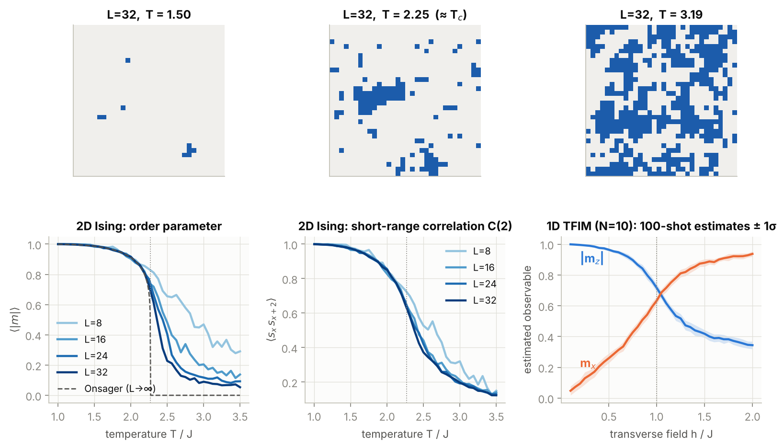
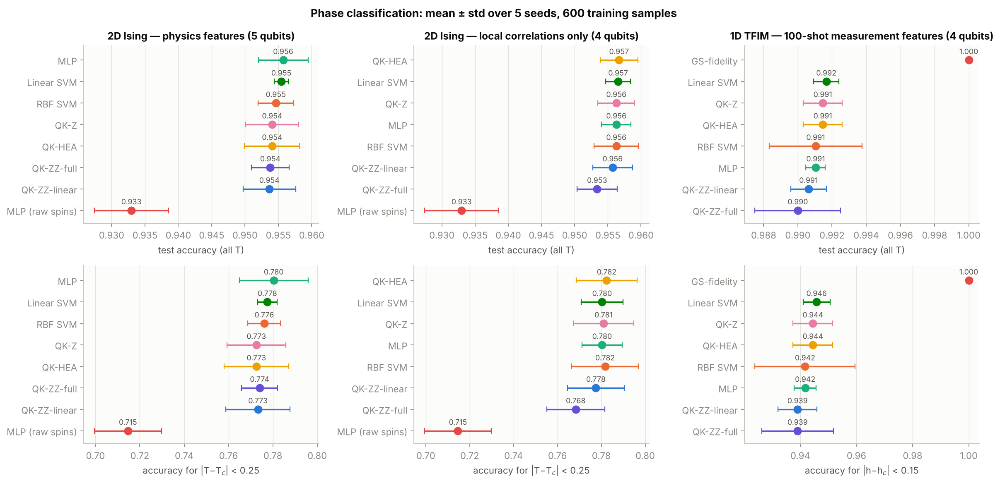
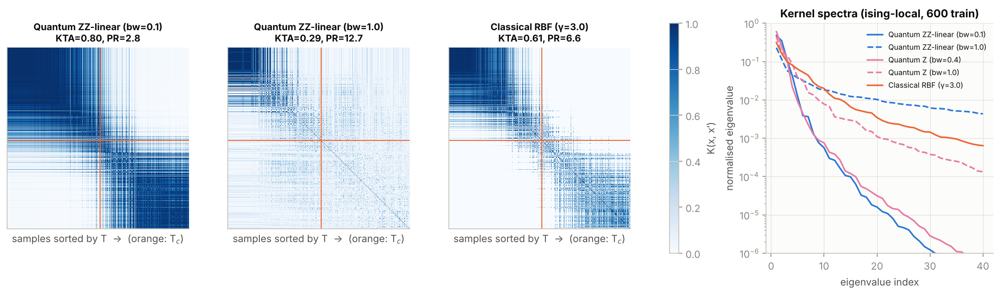
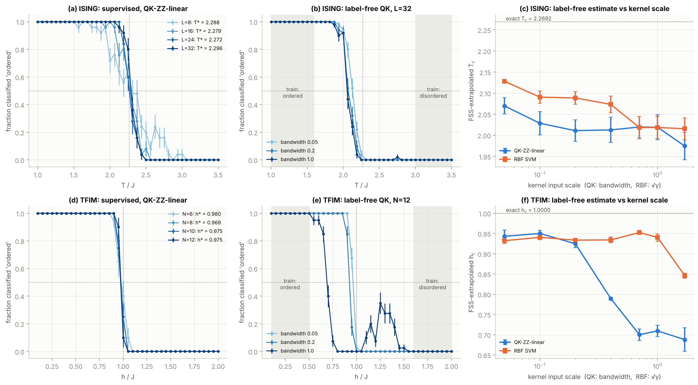
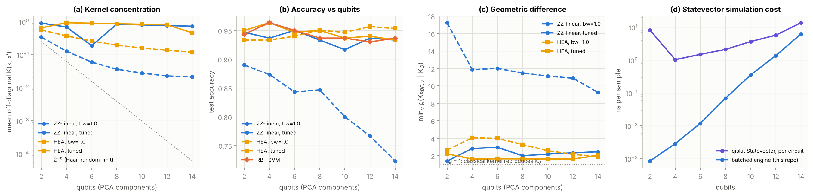
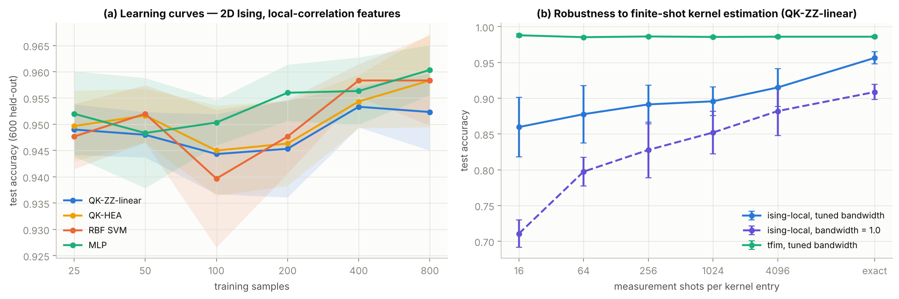

# Quantum Kernel Learning for Detecting Phase Transitions in Statistical and Quantum Spin Systems

[](https://github.com/A669-TECH/quantum-kernel-phase-transitions/actions/workflows/tests.yml)


**Research question.** Can quantum feature maps and fidelity quantum kernels pick out the patterns behind a phase transition? And how do they compare with classical kernels and neural networks, both on accuracy and on the reasons they generalise or fail?

The project tests both a **classical thermal transition**, the 2D Ising model (Monte Carlo), and a **quantum phase transition**, the 1D transverse-field Ising model (exact diagonalisation plus simulated projective measurements). It compares four Qiskit feature maps against linear/RBF SVMs and MLPs under one shared tuning protocol. It also looks at kernel geometry, the critical point, qubit scaling, and finite-shot noise.

<p align="center"></p>

---

## Key findings

| # | Finding | Evidence |
|---|---|---|
| 1 | **Quantum kernels reach the accuracy ceiling but do not beat classical kernels.** All 7 feature-based models are within 0.4 percentage points of each other (≈95.6 % on 2D Ising, ≈99.1 % on the TFIM). | Fig. 2, `benchmark_summary.csv` |
| 2 | **The ceiling comes from the physics, not from model capacity.** Near T<sub>c</sub>, finite-size configurations are physically ambiguous: every model scores 77–78 % inside the window \|T−T<sub>c</sub>\| < 0.25. | Fig. 2 bottom row |
| 3 | **Bandwidth is the most important hyper-parameter.** At bandwidth 1 the ZZ kernel is concentrated (target alignment 0.29, flat spectrum). At the CV-selected bandwidth (0.05–0.1) it is smooth, low-rank and well aligned (0.80). Its geometric difference to the best RBF kernel is then only g ≈ 1.6, so a classical kernel can reproduce it. | Fig. 3, `kernel_geometry_ising_local.csv` |
| 4 | **Supervised kernels locate the transition accurately.** Finite-size scaling of the classifier crossing gives T<sub>c</sub> = 2.282 ± 0.013 with the quantum kernel (exact 2.2692, 0.6 % error) and h<sub>c</sub> = 0.969 ± 0.009 for the TFIM (exact 1). | Fig. 4 a,d |
| 5 | **Without labels near the transition, every kernel is biased, and the quantum kernel is the most sensitive to its scale.** Training only deep inside each phase gives T<sub>c</sub> ≈ 1.98–2.13 for all kernels. For the TFIM, the quantum-kernel estimate ranges from 0.69 to 0.95 as the bandwidth changes; for RBF the range is 0.85–0.95. | Fig. 4 b,c,e,f |
| 6 | **Kernel concentration appears as qubits are added.** At a fixed bandwidth, the mean off-diagonal ZZ kernel value falls 16× from 2 to 14 qubits and accuracy drops from 0.89 to 0.72. Re-tuning the bandwidth (it shrinks with qubit count) recovers RBF-level accuracy. | Fig. 5 |
| 7 | **There is a trade-off between bandwidth and shot noise.** The bandwidth that wins with exact kernels puts every kernel entry close to 1, so finite shots erase the differences between them (95.6 % → 86 % at 16 shots). The TFIM kernel, with a moderate bandwidth and strong regularisation, stays at 98.6 % even at 16 shots. | Fig. 6b |
| 8 | **Kernels built from the physical quantum states are perfect.** An SVM on the ground-state fidelity \|⟨ψ(h)\|ψ(h′)⟩\|² scores 100 %. Classical encodings of 100-shot measurement data score 99 %. | Fig. 2 (TFIM) |

**Bottom line.** These order-parameter problems have low-dimensional, intensive features, and on them quantum kernels are *competitive, not advantageous*. The kernel-geometry diagnostics explain why. The strongest signal comes from giving the kernel **quantum data** (states) rather than classically encoded features. This is the regime where quantum ML is expected to matter, and it is the natural next step (see [Future work](#limitations-and-future-work)).

---

## Physical systems

### 2D classical Ising model
$$H = -J\sum_{\langle ij\rangle} s_i s_j,\qquad s_i=\pm1,\qquad T_c = \frac{2J}{\ln(1+\sqrt2)} \approx 2.2692$$

Configurations are sampled with the **Wolff cluster algorithm**, compiled with Numba, which avoids critical slowing-down. The settings are L ∈ {8, 16, 24, 32}, 41 temperatures in [1.0, 3.5], 50 configurations per temperature drawn from 5 independent chains, and 500 thermalisation sweeps. The sampler reproduces Onsager's exact magnetisation (Fig. 1).

| Feature set | Features | Qubits | Purpose |
|---|---|---|---|
| `physics` | \|m\|, e, C(2), C(L/4), C(L/2) | 5 | includes the order parameter |
| `local` | e, C(2), C(3), C<sub>diag</sub>(1) | 4 | short-range only, so the order must be inferred |
| `pca` | top-d principal components of raw spins | d = 2…14 | dial qubit count for scaling |
| raw | all L² spins | — | MLP baseline |

### 1D transverse-field Ising model (quantum)
$$H = -J\sum_i Z_iZ_{i+1} - h\sum_i X_i,\qquad h_c/J = 1$$

Ground states come from exact diagonalisation with periodic boundaries, N ∈ {6, 8, 10, 12}. A unit test checks them against the analytic free-fermion energy to 10⁻⁹. To mimic data from a quantum simulator, each sample is built from **100 projective measurements in the Z basis and 100 in the X basis**. The features (\|m<sub>z</sub>\|, C<sub>zz</sub>(1), C<sub>zz</sub>(N/2), m<sub>x</sub>) therefore carry real shot noise. The settings are 39 fields in [0.1, 2.0] with 40 samples per field.

---

## Method

### Quantum kernel
$$K(x_i,x_j)=|\langle\phi(x_i)|\phi(x_j)\rangle|^2,\qquad |\phi(x)\rangle = U(\lambda\, z(x))\,|0\rangle^{\otimes n}$$

Here z(x) is the standardised feature vector and λ is the **bandwidth**. Each feature map is written once as a sequence of gate calls. It is then either compiled to a Qiskit `QuantumCircuit` or evolved by the repo's **batched statevector engine**, which simulates all N samples at once. The batched engine matches `qiskit.quantum_info.Statevector` and Qiskit's library `zz_feature_map` / `z_feature_map` to 10⁻¹⁰, and the full kernel matches `qiskit_machine_learning.FidelityStatevectorKernel` (`tests/`). Building the Gram matrix needs N simulations plus one matrix product, instead of N² compute-uncompute circuits.

| Map | Circuit (per layer, 2 layers) | Notes |
|---|---|---|
| `Z` | H, P(2x<sub>i</sub>) | product state → the kernel factorises into cosines (classical control) |
| `ZZ-linear` | H, P(2x<sub>i</sub>), CX·P(2(π−x<sub>i</sub>)(π−x<sub>j</sub>))·CX on neighbours | Havlíček et al. 2019 |
| `ZZ-full` | same, all pairs | more entanglement |
| `HEA` | RY(x<sub>i</sub>)RZ(x<sub>i</sub>), CZ chain | hardware-efficient data re-uploading; no SWAPs on heavy-hex |

### Protocol
- **Labels:** ordered (T < T<sub>c</sub>, h < h<sub>c</sub>) vs disordered.
- **Splits:** stratified by temperature/field; 600 training samples (test: 1450 for Ising, 960 for TFIM); 5 seeds.
- **Tuning:** every model, quantum or classical, is tuned with the same `GridSearchCV` (3-fold). Quantum kernels search bandwidth × C; RBF searches γ × C; MLPs search α.
- **Metrics:** accuracy, ROC-AUC, near-critical accuracy, fit time.
- **Diagnostics:** kernel-target alignment, spectrum and participation ratio, concentration, and the geometric difference g(K<sub>C</sub>‖K<sub>Q</sub>) of Huang et al. (2021), minimised over RBF bandwidths.

---

## Results

### 1. Classification benchmark

<p align="center"></p>

| Model | Ising (physics) | Ising (local) | TFIM (measurements) |
|---|---|---|---|
| **QK-ZZ-linear** | 0.954 ± 0.004 | 0.956 ± 0.003 | 0.991 ± 0.001 |
| **QK-ZZ-full** | 0.954 ± 0.003 | 0.953 ± 0.003 | 0.990 ± 0.003 |
| **QK-HEA** | 0.954 ± 0.004 | **0.957 ± 0.003** | 0.991 ± 0.001 |
| **QK-Z** (product) | 0.954 ± 0.004 | 0.956 ± 0.003 | 0.991 ± 0.001 |
| Linear SVM | 0.955 ± 0.001 | 0.957 ± 0.002 | **0.992 ± 0.001** |
| RBF SVM | 0.955 ± 0.003 | 0.956 ± 0.003 | 0.991 ± 0.003 |
| MLP (features) | **0.956 ± 0.004** | 0.956 ± 0.002 | 0.991 ± 0.001 |
| MLP (raw spins) | 0.933 ± 0.006 | 0.933 ± 0.006 | — |
| GS-fidelity kernel (quantum states) | — | — | **1.000 ± 0.000** |

All differences between feature-based models are smaller than the seed-to-seed spread. The entangling ZZ maps gain nothing over the product-state `Z` map, which is classically simulable. Hand-built physical features beat the raw-spin MLP by 2 points at this training size.

### 2. Kernel geometry: why bandwidth matters

<p align="center"></p>

| Kernel (Ising-local, 600 train) | KTA ↑ | Participation ratio | min<sub>γ</sub> g(K<sub>RBF</sub>‖K) |
|---|---|---|---|
| Quantum ZZ-linear, bw = 0.1 (CV-selected) | **0.80** | 2.8 | 1.61 |
| Quantum ZZ-linear, bw = 1.0 | 0.29 | 12.7 | 16.2 |
| Quantum Z, bw = 0.4 | 0.77 | 2.3 | 1.32 |
| Classical RBF, γ = 3 | 0.61 | 6.6 | 1.00 |

At bandwidth 1 the ZZ kernel is a near-diagonal "memorising" kernel with a flat spectrum. Its g ≫ 1 only says that *some* labellings would favour it, not that these labels do, and it generalises worse. At the CV-selected bandwidth the kernel becomes smooth, two-block and phase-aligned, and g → 1.6. Small-bandwidth quantum kernels behave like classical low-order polynomial kernels, as Shaydulin & Wild (2022) and Canatar et al. (2023) predict.

### 3. Locating the critical point

<p align="center"></p>

| Protocol | System | Quantum kernel | RBF | Exact |
|---|---|---|---|---|
| Supervised crossing + FSS (T*(L) = T<sub>c</sub> + a/L) | 2D Ising | **2.282 ± 0.013** | 2.292 ± 0.009 | 2.2692 |
| | 1D TFIM | 0.969 ± 0.009 | **1.012 ± 0.012** | 1 |
| Label-free (trained deep in each phase), range over kernel scale | 2D Ising | 1.98 – 2.07 | 2.02 – 2.13 | 2.2692 |
| | 1D TFIM | 0.69 – 0.95 | 0.85 – 0.95 | 1 |

The phase curves sharpen with system size, as expected from finite-size rounding. When nothing near the transition is labelled, the max-margin boundary falls wherever the kernel geometry puts it. The estimate is then biased low and depends on the hyper-parameter. Panel (e) shows the quantum kernel at large bandwidth flipping predictions non-monotonically between the two training regions, which the smoother RBF kernel does not do. *We also tried learning-by-confusion (van Nieuwenburg et al. 2017). With flexible kernel SVMs the accuracy curve was a broad plateau rather than a sharp W, so it was too noisy for finite-size scaling.*

### 4. Scaling with qubits

<p align="center"></p>

The input is Ising L = 16, compressed to d principal components, so d qubits.
- **(a, b)** At a fixed bandwidth of 1, the mean off-diagonal ZZ kernel value drops from 0.34 (2 qubits) to 0.021 (14 qubits) and accuracy from 0.89 to 0.72. Concentration sets in quickly but then levels off well above the 2⁻ⁿ Haar-random floor, because the data are structured rather than random. The HEA map, with less entanglement, concentrates more slowly (0.56 → 0.12). Tuned kernels keep their mean off-diagonal value between 0.19 and 0.93, far above the 2⁻ⁿ floor.
- With CV tuning, the selected bandwidth *shrinks* as qubits are added (0.05 → 0.02). Accuracy then stays at 0.92–0.95, matching RBF (0.93–0.96).
- **(c)** For tuned kernels, g(K<sub>RBF</sub>‖K<sub>Q</sub>) stays between 1.4 and 3 at every width, so there is no room for a quantum advantage on this data.
- **(d)** The batched engine is 100–350× faster than per-circuit Qiskit simulation at 4–6 qubits, where Python overhead dominates. The gap narrows to about 2× at 14 qubits, where the cost is the statevector itself.

### 5. Data efficiency and finite-shot robustness

<p align="center"></p>

- **Learning curves:** every model is already at about 95 % with 25 training samples. No model is more data-efficient than the others on this task.
- **Shot noise:** each kernel entry is replaced by Binomial(S, K)/S, which is exactly the statistic a compute-uncompute circuit gives on hardware, and the Gram matrix is projected back to PSD. On Ising-local, the tuned kernel (bandwidth 0.05, C = 100) drops from 95.6 % to 91.5 % at 4096 shots and to 86 % at 16 shots, because all its entries lie close to 1. The concentrated kernel at bandwidth 1 falls to 71 %. The TFIM kernel (bandwidth 0.4, C = 0.1) is unaffected even at 16 shots. **The bandwidth that is optimal for exact kernels is not optimal for hardware**, and the two have to be tuned together.

### Real compute-uncompute circuits

`scripts/hardware_kernel_demo.py` builds the actual circuit U(x<sub>j</sub>)<sup>†</sup>U(x<sub>i</sub>) and estimates each kernel entry with Qiskit primitives. On the local `StatevectorSampler` with 4096 shots, all 8 test entries agree with the exact fidelity to within 0.007. With `--backend <ibm_device>` the same script transpiles the circuits for IBM hardware and submits them through `qiskit-ibm-runtime`.

---

## Reproduce

```bash
git clone https://github.com/A669-TECH/quantum-kernel-phase-transitions.git
cd quantum-kernel-phase-transitions
pip install -e ".[qml,dev]"

pytest -q                          # 16 tests: simulator == Qiskit, TFIM == free-fermion solution, ...
bash scripts/run_all.sh            # full study, ~25 min on 2 CPU cores
bash scripts/run_all.sh --quick    # ~1 min smoke run (used in CI)
python scripts/hardware_kernel_demo.py --shots 4096   # add --backend ibm_xxx for a real device
```

Each experiment script also accepts `--plot-only`, which redraws its figures from the saved tables.

## Repository structure

```
src/qkpt/
  ising.py          Wolff cluster Monte Carlo for the 2D Ising model (Numba)
  tfim.py           TFIM Hamiltonian, exact ground states, projective-measurement sampling
  features.py       order parameter, energy, correlation functions, PCA features
  feature_maps.py   Z / ZZ-linear / ZZ-full / HEA maps, defined once
  simulator.py      batched statevector engine + Qiskit circuit export
  kernels.py        fidelity kernel, finite-shot estimator, PSD projection, RBF
  models.py         sklearn-compatible QuantumKernelSVC, state-overlap SVM, baselines
  metrics.py        kernel-target alignment, spectra, concentration, geometric difference
  criticality.py    phase curves, crossing fits, finite-size scaling
  experiment.py     shared split / tune / score protocol
scripts/
  generate_data.py           datasets + Fig. 1
  run_benchmark.py           Exp. 1: benchmark + kernel geometry (Figs. 2–3)
  run_critical_point.py      Exp. 2: critical point + FSS (Fig. 4)
  run_scaling.py             Exp. 3: qubit scaling, concentration, cost (Fig. 5)
  run_learning_and_noise.py  Exp. 4: learning curves, shot noise (Fig. 6)
  hardware_kernel_demo.py    compute-uncompute circuits on Qiskit primitives / IBM hardware
  run_all.sh
results/tables/   every number in this README, as CSV
results/figures/  every figure
tests/            correctness tests (run in CI)
```

## Limitations and future work

- **Feature encoding is the bottleneck.** These classical inputs are low-dimensional and intensive, and on such inputs a quantum kernel can at best re-express a smooth classical function. The 100 % result from the state-overlap kernel suggests the next step: kernels on **quantum data**, such as classical shadows of states from a quantum simulator, or **projected quantum kernels** (Huang et al. 2021).
- **QCNN comparison.** A quantum convolutional neural network (Cong, Choi & Lukin 2019) acting directly on TFIM / cluster-SPT ground states would test the regime where quantum models are believed to have a real advantage.
- **Hardware noise.** Shot noise is modelled exactly. Gate and readout noise are not modelled yet: the next step is running `hardware_kernel_demo.py` on an IBM device with error mitigation (e.g. TREX / ZNE).
- **Larger quantum systems.** Exact diagonalisation limits the TFIM to N ≤ 12. MPS/DMRG ground states would allow N ≈ 100 and a cleaner finite-size scaling, including an estimate of ν.
- **Hyper-parameter grids.** The CV-selected ZZ bandwidth hits the bottom of the grid at high qubit counts (0.02). Finer grids, or bandwidths chosen by kernel-target alignment, are worth testing.

## References

1. V. Havlíček et al., *Supervised learning with quantum-enhanced feature spaces*, Nature 567, 209 (2019).
2. M. Schuld & N. Killoran, *Quantum machine learning in feature Hilbert spaces*, PRL 122, 040504 (2019).
3. H.-Y. Huang et al., *Power of data in quantum machine learning*, Nat. Commun. 12, 2631 (2021).
4. R. Shaydulin & S. M. Wild, *Importance of kernel bandwidth in quantum machine learning*, PRA 106, 042407 (2022).
5. A. Canatar et al., *Bandwidth enables generalization in quantum kernel models*, TMLR (2023).
6. S. Thanasilp et al., *Exponential concentration in quantum kernel methods*, Nat. Commun. 15, 5200 (2024).
7. J. Carrasquilla & R. G. Melko, *Machine learning phases of matter*, Nat. Phys. 13, 431 (2017).
8. E. P. L. van Nieuwenburg, Y.-H. Liu & S. D. Huber, *Learning phase transitions by confusion*, Nat. Phys. 13, 435 (2017).
9. I. Cong, S. Choi & M. D. Lukin, *Quantum convolutional neural networks*, [Nat. Phys. 15, 1273 (2019)](https://www.nature.com/articles/s41567-019-0648-8).
10. U. Wolff, *Collective Monte Carlo updating for spin systems*, PRL 62, 361 (1989).
11. L. Onsager, *Crystal statistics I*, Phys. Rev. 65, 117 (1944).

## Citation

```bibtex
@software{qkpt2026,
  author = {Mahnoori, Aman},
  title  = {Quantum Kernel Learning for Detecting Phase Transitions in Statistical and Quantum Spin Systems},
  year   = {2026},
  url    = {https://github.com/A669-TECH/quantum-kernel-phase-transitions}
}
```

MIT License.
